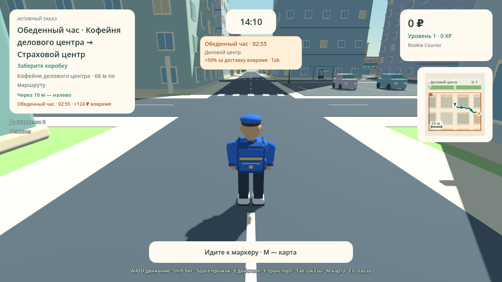

# Delivery Simulator

Editable Godot demo **0.12.0**. Open `GodotDemo/project.godot` with Godot 4.6.3.

**Lunch Rush** starts 45 seconds into a shift: for three minutes, up to three extra cafe-to-office orders appear in the business district alongside six normal offers. Deliver an event parcel before its timer ends for **50% extra Money**. Accepted parcels remain deliverable at normal pay afterwards. Another rush begins after a five-minute break. The event works in Solo, Competitive LAN and Team Shift; the Host controls its clock, shared orders and payouts.

LAN supports **Team Shift**: a fixed shared delivery goal, one-time personal bonus of 500 Money and 100 XP for a completed delivery contribution, and parcel handoffs requiring explicit consent through Tab. Friends can hand off Lunch Rush parcels using the same system. Competitive mode is the default.

The city is **516 × 516 metres**, with **104 buildings, 18 pickup points and 51 delivery addresses** across six districts. M opens the full city map with an event district highlight. The mini-map shows the nearby 128 metres; routes follow actual streets and paths, avoid buildings and mark the final walking approach. Beginning couriers get short local work; owned transport unlocks longer trips.

[Windows artifact](https://github.com/Dinmukhamad/Delivery-Simulator/actions/runs/38332681658/artifacts/11783219952) · [macOS artifact](https://github.com/Dinmukhamad/Delivery-Simulator/actions/runs/38332681658/artifacts/11783980787)

Unpack the download, then unpack the game ZIP inside it. Run the EXE on Windows or the app on macOS.

CI passed **5991 checks** across source and both exact target packs, with four two-process ENet scenarios and 16 actual UI/city renders.

LAN: Host Game → choose mode; friends Join Game using the Host IPv4 address, then Ready → Start. Same version **0.12.0**, same local network, UDP port 7777. Career profiles remain local.

[District events: source, setup and testing](docs/DISTRICT_EVENTS.md) · [City layout](docs/CITY_LAYOUT.md) · [Team Shift](docs/TEAM_SHIFT.md) · [Build evidence](docs/BUILD_REPORT.md) · [Recovery history](RECOVERY.md)

Native Windows/macOS launch, mixed-platform four-device LAN and FPS still require acceptance testing. This is the separately agreed Godot demo.

