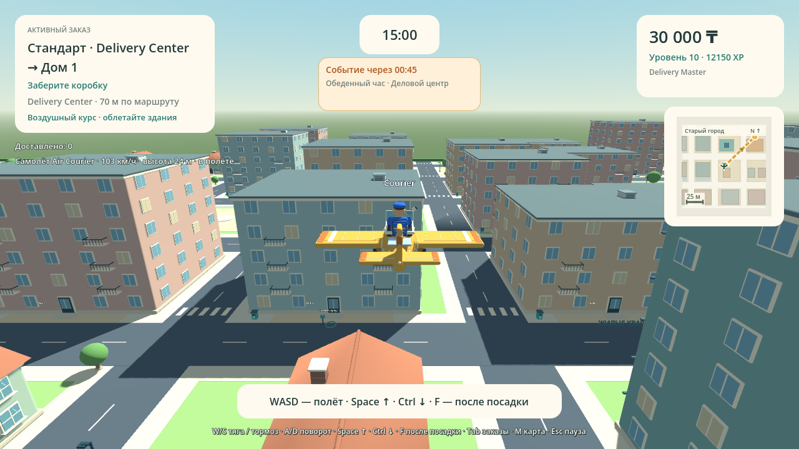

# Delivery Simulator

Editable Godot demo **0.15.0**. Open `GodotDemo/project.godot` with Godot 4.6.3.

**Tenge and flight:** all money displays use Kazakhstani tenge (₸), preserving existing amounts and purchases. The fourth Garage vehicle is **Air Courier**, a rounded mini airplane costing **30,000 ₸** at **level 8**. WASD throttle/turn, Space climb, Ctrl descend, neutral hover. Land and stop before F to exit. Flight is limited to 60m altitude with building collisions and LAN authority. DELIVERYMASTER + ALLVEHICLES also grants access. [Full source, setup and testing](docs/FLIGHT_TENGE.md).

**Cheat codes** open with F2 (Fn+F2 on some Macs), or the menu/pause button. Enter a code and press Enter or Apply. Codes ignore letter case and can be repeated. They update the local career profile; LAN grants are calculated by the Host for the requesting player. Grants do not count towards shift earnings, delivery statistics, Team Shift goals or district events.

| Code | Effect |
|---|---|
| MONEY10000 | +10,000 Money |
| MONEY50000 | +50,000 Money |
| XP1000 | +1,000 XP |
| LEVELUP | Next career level, up to 10 |
| DELIVERYMASTER | Level 10 |
| ALLVEHICLES | Own bicycle, scooter, car and airplane; normal level requirements remain |

**Customization** is available from Profile and Garage: courier outfits, backpack shapes and vehicle paint. Free styles work from the beginning; extra styles use Money. Purchases and equipped choices are saved locally and displayed to LAN friends.

The city is **516 × 516 metres**, with **104 buildings, 18 pickup points and 51 delivery addresses** across six districts. M opens the full map; routes follow the actual city geometry.

**Lunch Rush** starts 45 seconds into a shift: three minutes of extra cafe-to-office orders in the business district. Timely delivery pays 50% extra Money. LAN **Team Shift** adds shared goals, contribution bonuses and explicit parcel handoffs through Tab.

[Windows artifact](https://github.com/Dinmukhamad/Delivery-Simulator/actions/runs/39424298323/artifacts/12265354300) · [macOS artifact](https://github.com/Dinmukhamad/Delivery-Simulator/actions/runs/39424298323/artifacts/12266066581)

Unpack the download, then unpack the game ZIP inside it. Run the EXE on Windows or the app on macOS.

CI passed **11720 checks** across source and both exact target packs, seven actual two-process ENet scenarios, isolated career saves and **27 engine renders**.

LAN: Host Game → friends Join Game using the Host IPv4 → Ready → Start. Same version **0.15.0**, same local network, UDP port 7777. Career profiles remain local.

[Cheat codes: source, setup and testing](docs/CHEAT_CODES.md) · [Customization](docs/CUSTOMIZATION.md) · [District events](docs/DISTRICT_EVENTS.md) · [City](docs/CITY_LAYOUT.md) · [Team Shift](docs/TEAM_SHIFT.md) · [Build evidence](docs/BUILD_REPORT.md)

Native Windows/macOS launch, mixed-platform four-device LAN and FPS still require acceptance testing. This is the separately agreed Godot demo.

