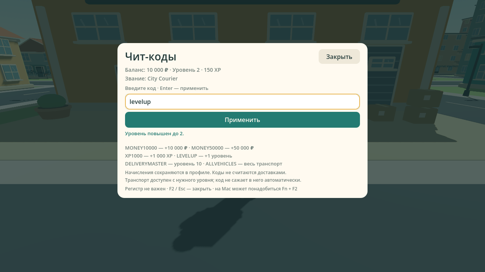
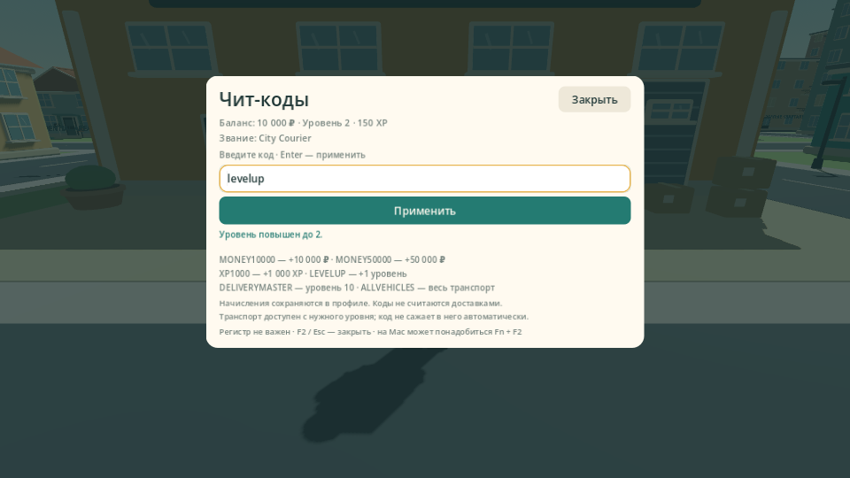
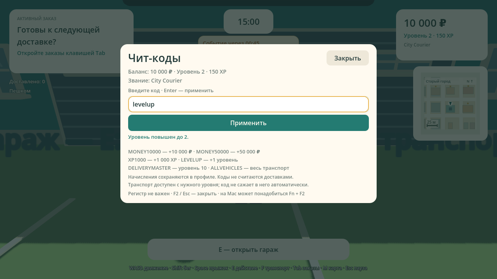

# Проверка Delivery Simulator Demo 0.14.0

Версия добавляет консоль чит-кодов: F2 (на некоторых Mac — Fn+F2), кнопки в меню и паузе, ввод через Enter или «Применить». Коды меняют личный карьерный профиль и сохраняются через обычный JSON Save System. В LAN начисления рассчитывает Host для отправителя запроса.

| Код | Действие |
|---|---|
| MONEY10000 | +10 000 денег |
| MONEY50000 | +50 000 денег |
| XP1000 | +1 000 XP |
| LEVELUP | Следующий уровень, максимум 10 |
| DELIVERYMASTER | Уровень 10, XP не уменьшается |
| ALLVEHICLES | Владение велосипедом, скутером и автомобилем; выбор/посадка выполняются в гараже, требования к уровню сохраняются |

Коды нечувствительны к регистру и допускают повторение. Деньги и XP ограничены 1 000 000 000. Начисления не прибавляют заработок смены, доставки, общий заработок, рекорды, командный прогресс или бонусы районных событий.

[Сборка GitHub Actions 38356153333](https://github.com/Dinmukhamad/Delivery-Simulator/actions/runs/38356153333) успешно завершилась на коммите `a44945bf22c7e5f8bc3800cfa303ef2c9958c6e7`. Последующее добавление отчёта и PNG не меняет проверенные скрипты, настройки или ресурсы игры.

## Подтверждённые результаты

| Проверка | Исходники | Windows PCK | macOS PCK |
|---|---:|---:|---:|
| Навигация и Solo | 688 | 688 | 688 |
| Геометрия, карты и транспорт | 649 | 649 | 649 |
| Генерация заказов и границы Host | 309 | 309 | 309 |
| Командная смена | 113 | 113 | 113 |
| Районные события | 197 | 197 | 197 |
| Кастомизация, совместимость и модели | 1219 | 1219 | 1219 |
| Чит-коды, уровни и интерфейс | 448 | 448 | 448 |

Шесть сценариев настоящего двухпроцессного ENet: навигация — **21** проверка, Team Shift — **36**, доставка в новых районах — **24**, «Обеденный час» — **42**, кастомизация и сохранение — **219**, чит-коды и сохранение — **248** (Host 92, Client 156). Итого **11459 проверок**, без двойного подсчёта повторных строк сетевого журнала.

- Проверены все шесть кодов, повторный ввод, нормализация регистра/пробелов, неизвестные и длинные строки, некорректные типы и управляющие символы. Произвольные команды не выполняются.
- Проверены все границы 10 уровней и пяти рангов, XP следующего уровня, сохранение большего XP, лимит 1 000 000 000 и обычная успешная доставка при достигнутом лимите. Реальная награда учитывается в статистике доставки/смены; повторное взаимодействие не выдаёт её дважды.
- ALLVEHICLES даёт владение транспортом, сохраняет текущий выбор и не создаёт/не захватывает транспорт. Обычные требования гаража к уровню действуют.
- В LAN Host определяет отправителя: запрос содержит только код. Подменённые сумма, цель или поля профиля отвергаются; начисления не меняют профиль второго игрока. Ограничена частота запросов и ответов об отказе.
- Проверены активный заказ, сроки, косметика, выбранный транспорт и отсутствие искусственного заработка в таблице результатов, командном прогрессе или районном событии. Уровень и звание обновляются в сетевом списке игроков.
- Два процесса записывают настоящие JSON-профили в отдельных временных XDG-папках, сравнивают каждое сохранённое поле и повторно загружают профиль производственным загрузчиком после выхода. Обычные личные сохранения защищены test-mode и проверкой временного пути.
- Проверены настоящие кнопки/Enter, фокус и сохранение текста/каретки, F2/Esc, запрет управления при вводе, возврат в меню/паузу/заказы/карту/гараж/внешний вид, потеря фокуса и недоступность на результатах/в Lobby/при настройке экрана.
- Выполнены **23 настоящих рендера**: прежние 20 города, карты, Team Shift, событий и кастомизации плюс три консоли — меню 1280×720 и 960×540, игра 1280×720. Новый рендер начинается с настоящего профиля 0 денег/0 XP/уровень 1 и вводит MONEY10000 через Enter, LEVELUP через «Применить». Проверены ровно два начисления, живые подписи 10 000 денег/150 XP/уровень 2 и видимость всех шести кодов/кнопок.
- Подтверждены Windows PE x86_64, macOS Universal Mach-O Intel + Apple Silicon, SHA256 Godot 4.6.3 и шаблонов, CRC ZIP. Версии приложения, LAN и экспорта — 0.14.0.

Карта — 516 × 516 м, 104 здания, 18 точек получения и 51 адрес доставки. Прежние доставки, Team Shift, передачи посылок, «Обеденный час» и кастомизация прошли регрессионные проверки.

## Архивы

Ссылки ведут на внешние ZIP артефактов: распакуйте скачанный архив, затем ZIP игры внутри. Размер и SHA256 относятся к внешнему архиву.

| Артефакт | Размер, байт | SHA256 |
|---|---:|---|
| [DeliverySimulatorDemo-macOS-v0.14.0](https://github.com/Dinmukhamad/Delivery-Simulator/actions/runs/38356153333/artifacts/11793950006) | 65437930 | `9ba89416249c081b99bb7b4e148c466caa2b038842ca30bfa6a47973f95f6e12` |
| [DeliverySimulatorDemo-Source-v0.14.0](https://github.com/Dinmukhamad/Delivery-Simulator/actions/runs/38356153333/artifacts/11793580413) | 6182940 | `6f1a974e9bfebb08c7762a6bad5495aa17397745d7aa703d3e05ccc7dfd519d4` |
| [DeliverySimulatorDemo-Windows-v0.14.0](https://github.com/Dinmukhamad/Delivery-Simulator/actions/runs/38356153333/artifacts/11793520371) | 38950820 | `286d7a49c34c899080073b78feadbb7092a17f6ba0033bf99effe1691dcb7bc4` |
| [build-reports](https://github.com/Dinmukhamad/Delivery-Simulator/actions/runs/38356153333/artifacts/11793250649) | 4299934 | `9883268a9560270ff7728baa2ea352a86d95394807251f832d5b8da7d656c57f` |

Исходный архив CI содержит документацию на момент проверенного коммита. Актуальные отчёт, полные исходники и снимки находятся в текущей ветке репозитория.

## Пределы проверки

CI использует Linux-редактор Godot и программный OpenGL. Проверка точных экспортированных PCK подтверждает код и ресурсы, но не является нативным запуском EXE или macOS-приложения. LAN на 3–4 физических Windows/macOS-устройствах, FPS и слышимость звуков требуют ручной приёмки. macOS-сборка не нотарифицирована. Это согласованная отдельная Godot-демоверсия.

## Снимки

Кадры получены из реально отрисованного viewport. Новая консоль показывает профиль после двух настоящих вводов через интерфейс. Деньги/XP не подменяются для подписи; статистика и заработок остаются прежними. Положение игрока и остановленный визуальный таймер служат фикстурами, физика и настоящая камера SpringArm работают.

[Полный код, настройка и сценарий приёмки](CHEAT_CODES.md) · [Кастомизация](CUSTOMIZATION.md) · [События](DISTRICT_EVENTS.md) · [Город](CITY_LAYOUT.md) · [Team Shift](TEAM_SHIFT.md)
