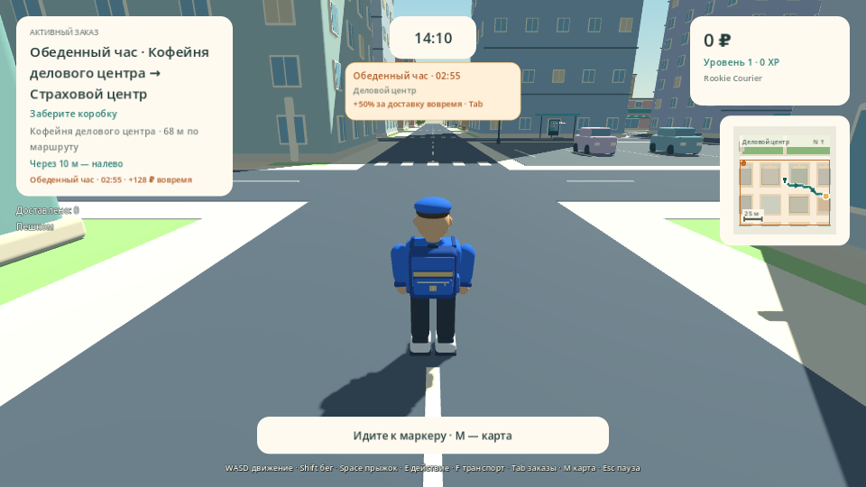
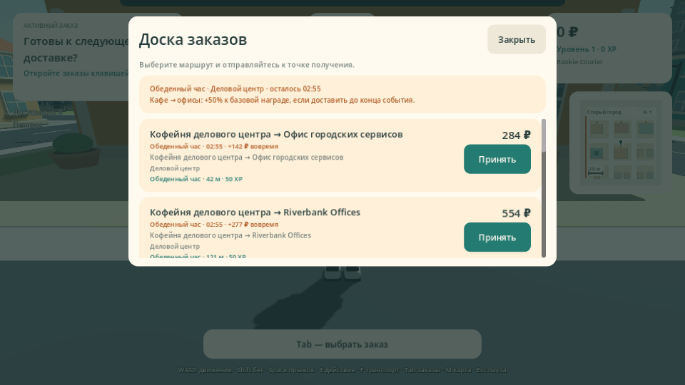
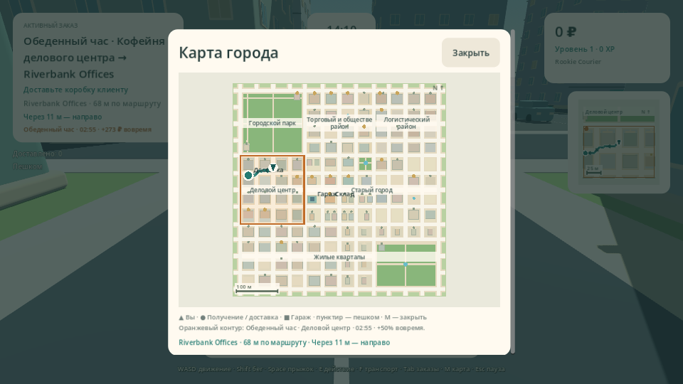

# Проверка Delivery Simulator Demo 0.12.0

[Сборка GitHub Actions 38332681658](https://github.com/Dinmukhamad/Delivery-Simulator/actions/runs/38332681658) завершилась успешно на коммите `bd361bd4bde53e0d2230c3ad1e9e30f12fa509d4`. Последующие изменения документации и PNG не меняют проверенные скрипты, настройки или ресурсы игры.

Событие «Обеденный час» работает в Solo и LAN по одной политике: первый запуск на 45-й секунде, длительность 180 секунд, затем перерыв 300 секунд. До трёх заказов кофейня → офис дополняют шесть обычных. За доставку до своего срока Host начисляет 50% дополнительных денег; поздняя принятая посылка сохраняет базовую стоимость.

## Подтверждённые результаты

| Проверка | Исходники | Windows PCK | macOS PCK |
|---|---:|---:|---:|
| Навигация и Solo | 688 | 688 | 688 |
| Геометрия, карты и транспорт | 649 | 649 | 649 |
| Генерация заказов и границы Host | 309 | 309 | 309 |
| Командная смена | 113 | 113 | 113 |
| Районное событие и обычные пути Solo/Host | 197 | 197 | 197 |

Дополнительно прошли четыре сценария настоящего двухпроцессного ENet: навигация — **21** проверка, Team Shift — **36**, доставка за прежней границей города — **24**, «Обеденный час» — **42**. Итого **5991 проверка**, без повторного подсчёта дублирующихся строк сетевого журнала.

- Проверены точные границы 45/225/525 секунд, сохранение шести обычных заказов и двух коротких маршрутов, реальные адреса кафе и офисов.
- Host отклоняет конкурентное принятие занятого заказа, поддельные награды/точки/сроки и доставку вне расстояния взаимодействия. Повторное подтверждение не начисляет награду второй раз.
- Посылка сохраняет ID события, срок и стоимость при передаче другу. Деньги и личная доставка достаются завершившему курьеру; командный план увеличивается на одну доставку.
- Принятые и полученные посылки остаются выполнимыми после события за базовую оплату, включая начало следующего «Обеденного часа».
- Solo проверен обычными `_accept_order` и `_interact`: получение и передача у настоящих адресов, своевременная/поздняя оплата, остановка времени при паузе, сброс следующей смены.
- В сетевом тесте время и исходные подходы задаёт доверенная фикстура Host. Затем Client действительно идёт, нажимает E, получает подтверждение обычным RPC и точный бонус. Позиции, расстояние и владение проверяются производственным кодом.
- Сохранены проверки изолированной JSON-записи профилей Host/Client командной смены; новые тесты события в `--test-mode` не меняют личные файлы.
- Выполнены **16 настоящих рендеров**: прежние 12 карт/города/Team Shift и четыре экрана события — HUD при 1280×720 и 960×540, Tab и M при 960×540. Проверены кнопки закрытия, отсутствие пересечения карточек, таймер/бонус, выделение района, готовый маршрут и работающая камера от третьего лица.
- Проверены Windows PE x86_64, macOS Universal Mach-O Intel + Apple Silicon, SHA256 редактора/шаблонов Godot 4.6.3 и CRC ZIP. В project.godot, LAN-протоколе и параметрах экспорта установлена версия 0.12.0.

Карта остаётся 516 × 516 м с 104 зданиями, 18 точками получения и 51 адресом доставки. Клиентские счётчики времени используются для отображения; Host определяет срок и оплату.

## Архивы

Ссылки ведут на внешние ZIP артефактов: распакуйте скачанный архив, затем ZIP игры внутри. SHA256 относится к внешнему архиву.

| Артефакт | Размер, байт | SHA256 |
|---|---:|---|
| [build-reports](https://github.com/Dinmukhamad/Delivery-Simulator/actions/runs/38332681658/artifacts/11784140534) | 3462842 | `59703ddfcecff066a99a9b905b1157a9f135ebaad172a1e2b429c05778a08d8f` |
| [DeliverySimulatorDemo-macOS-v0.12.0](https://github.com/Dinmukhamad/Delivery-Simulator/actions/runs/38332681658/artifacts/11783980787) | 65393059 | `01162f04aa771f28d864f2493df6fcf5348c44d147fb93aa9141e2616797d4b4` |
| [DeliverySimulatorDemo-Source-v0.12.0](https://github.com/Dinmukhamad/Delivery-Simulator/actions/runs/38332681658/artifacts/11783886124) | 5069161 | `6f6584ada240c3df31dd87f62b9f58473f160a44e326b91bb33b93611db6c72e` |
| [DeliverySimulatorDemo-Windows-v0.12.0](https://github.com/Dinmukhamad/Delivery-Simulator/actions/runs/38332681658/artifacts/11783219952) | 38905964 | `c502618f31ed6d85705b8be223ea9cf34736284dbde5b103542750f5f709bb13` |

Исходный архив CI содержит документацию на момент проверенного коммита. Актуальные отчёт и изображения находятся в текущей ветке репозитория.

## Пределы проверки

CI использует Linux-редактор Godot и программный OpenGL. Проверка точных экспортированных PCK подтверждает код и ресурсы, но не является нативным запуском EXE или macOS-приложения. Совместный LAN на 3–4 физических Windows/macOS-устройствах, FPS и слышимость звуков требуют ручной приёмки. macOS-сборка не нотарифицирована. Это согласованная отдельная Godot-демоверсия.

## Снимки события

Кадры получены из настоящих узлов игры и сгенерированных обычным кодом заказов. Тест продвигает локальный отсчёт к началу события и ставит персонажа в деловом центре. Камера SpringArm работает в обычном режиме; управление отключено для неподвижного кадра. Карта использует явно заданное тестовое состояние полученной посылки с сохранённым настоящим ID и сроком.

[Полный код, настройка и сценарий проверки](DISTRICT_EVENTS.md) · [Город](CITY_LAYOUT.md) · [Team Shift](TEAM_SHIFT.md) · [Навигация](NAVIGATION.md)
