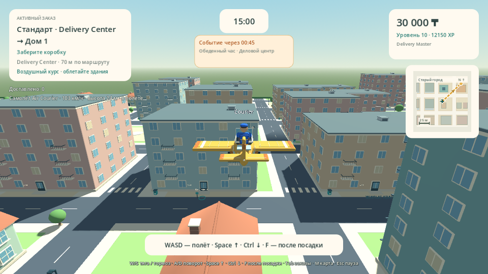
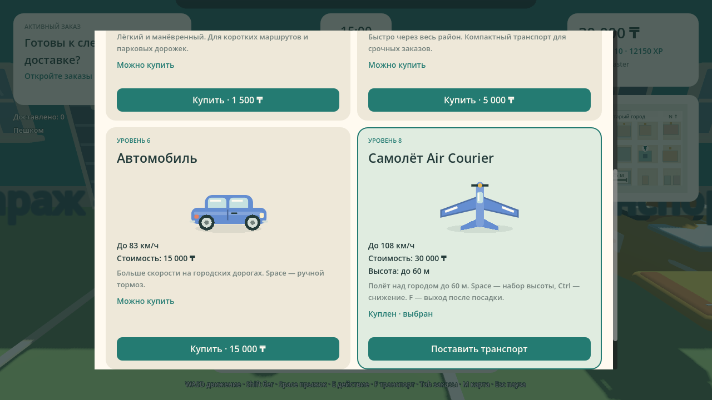
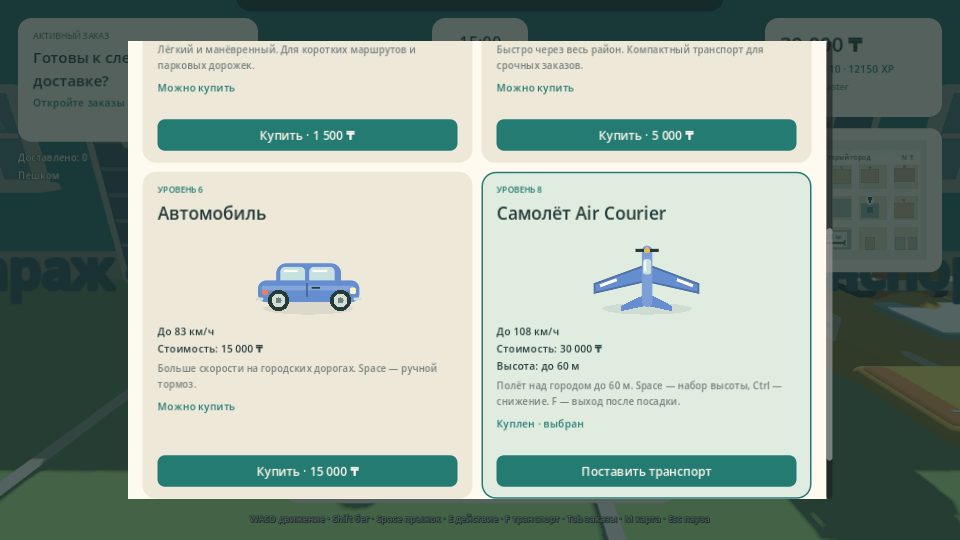

# Проверка Delivery Simulator Demo 0.15.0

Деньги в интерфейсе, ценах, наградах, результатах, косметике и чит-кодах отображаются в **тенге (₸)**. Числа баланса/цен, старые покупки, XP и статистика не конвертируются и сохраняются при загрузке прежних профилей.

Четвёртый транспорт — **Самолёт Air Courier**, **30 000 ₸**, **уровень 8**. WASD — газ/поворот, Space — подъём, Ctrl — снижение, отпускание подъёма/снижения — удержание высоты. Максимум 108 км/ч и 60 м; здания, крыши, крылья и границы города участвуют в проверках столкновений. Выйти можно после посадки на улице и остановки. DELIVERYMASTER → ALLVEHICLES открывают доступ через существующие чит-коды, вызов выполняется в гараже.

[GitHub Actions 39424298323](https://github.com/Dinmukhamad/Delivery-Simulator/actions/runs/39424298323) успешно завершился на коммите `9095f968046dc2619e2bd9f44696073093fd7cd2`. Последующее добавление отчёта и PNG не меняет проверенные скрипты, настройки или ресурсы игры.

## Подтверждённые результаты

| Проверка | Исходники | Windows PCK | macOS PCK |
|---|---:|---:|---:|
| Навигация и Solo | 688 | 688 | 688 |
| Геометрия, карты и транспорт | 649 | 649 | 649 |
| Заказы и границы Host | 309 | 309 | 309 |
| Командная смена | 113 | 113 | 113 |
| Районные события | 197 | 197 | 197 |
| Кастомизация и профили | 1219 | 1219 | 1219 |
| Чит-коды, уровни и интерфейс | 449 | 449 | 449 |
| Самолёт, тенге, физика и Host | 61 | 61 | 61 |

Семь настоящих двухпроцессных сценариев ENet: навигация — **21**, Team Shift — **36**, доставка в новых районах — **24**, «Обеденный час» — **42**, кастомизация — **219**, чит-коды — **248**, самолёт — **75** (Host 35, Client 40). Итого **11720 проверок**, без двойного подсчёта повторных строк сетевого журнала.

- Старые профили сохраняют числовые деньги, XP, ранги, покупки, выбранный транспорт и статистику. ALLVEHICLES добавляет четвёртый ID airplane; сам по себе этот код не снимает требования к уровню.
- Проверены настоящая покупка/выбор/вызов самолёта за точную цену, отсутствие повторного списания при вызове, вход, подъём, удержание высоты, снижение, потолок, столкновение крылом/крышей и безопасный выход.
- Host проверяет владельца, активный транспорт и поколение объекта, конечность координат/скорости, горизонтальный путь, подъём/снижение/поворот, высоту и полный объём перемещения. Такие же ограничения действуют для Host. Подмена grounded и мгновенный прыжок/разворот не разрешают полёт или выход.
- Для хрупкого груза проверены измеренный удар при посадке и отсутствие искусственного повреждения от подменённой скорости без соответствующего перемещения/контакта.
- Два реальных ENet-процесса покупают собственные самолёты, видят полёт друг друга, получают правильный тип/направление иконки карты, отклоняют F в воздухе и некорректные RPC, снижаются и выходят. Подтверждённые покупки сохраняются в отдельных временных XDG-папках и повторно загружаются штатным JSON-загрузчиком.
- Воздушный курс не создаёт уличные AStar-сетки; некорректные координаты не дают NaN-маршрут. После выхода работает обычная наземная навигация. Доставку у адреса выполняют пешком.
- Звук винта загружается через общий AudioManager, при полёте не воспроизводятся шаги, выход/остановка игрового контекста отключают двигатель. Оригинальный CC0 клип и его генератор включены в исходники.
- Валюта в исполняемых скриптах — ₸; числовые суммы не конвертируются. Настоящие HUD/гараж/читы отображаются в тенге. В гараже четыре прокручиваемые карточки в двух колонках; окраска и иконки поддерживают самолёт.
- Выполнены **27 реальных рендеров**: прежние 23 плюс полёт 1280×720/960×540 и гараж 1280×720/960×540. Проверены полный самолёт по углам AABB всех видимых мешей, камера, высота, кнопки, тенге и отсутствие обрезания подсказки полёта.
- Подтверждены Windows PE x86_64, macOS Universal Mach-O Intel + Apple Silicon, SHA256 редактора Godot 4.6.3/шаблонов и CRC вложенных ZIP. Версии приложения, LAN и экспорта — 0.15.0.

Карта остаётся 516 × 516 м: 104 здания, 18 точек получения, 51 адрес доставки. Прежние три наземных транспорта, заказы, Team Shift, районные события, кастомизация и чит-коды прошли регрессионные проверки.

## Архивы

Распакуйте скачанный ZIP артефакта, затем ZIP игры внутри. Размер и SHA256 внешнего архива получены из метаданных GitHub.

| Артефакт | Размер, байт | SHA256 |
|---|---:|---|
| [DeliverySimulatorDemo-Source-v0.15.0](https://github.com/Dinmukhamad/Delivery-Simulator/actions/runs/39424298323/artifacts/12266825722) | 6531076 | `1e86afe2f58139f7025863ed8de48c4735a7c3c8456bedea3acc8c87166f5d2b` |
| [build-reports](https://github.com/Dinmukhamad/Delivery-Simulator/actions/runs/39424298323/artifacts/12266311320) | 5109802 | `1e1676cb5c8fe1826d202515a486e099ae69b6b062351e13a397eaa7aca82087` |
| [DeliverySimulatorDemo-macOS-v0.15.0](https://github.com/Dinmukhamad/Delivery-Simulator/actions/runs/39424298323/artifacts/12266066581) | 65462753 | `69c828077dfe5c15c94d18c171a1a5c501abad3e1676c79521fcd3fe2a74de22` |
| [DeliverySimulatorDemo-Windows-v0.15.0](https://github.com/Dinmukhamad/Delivery-Simulator/actions/runs/39424298323/artifacts/12265354300) | 38973316 | `7e96dd2b394ab68d267f56da75707acc71b9ddf135211284c70385ae29a0a97e` |

Исходный архив содержит документацию проверенного коммита. Актуальные отчёт и кадры добавлены отдельным коммитом в репозитории.

## Пределы проверки

CI использует Linux-редактор Godot и программный OpenGL. Проверка точных экспортированных PCK подтверждает код и ресурсы, но не является нативным запуском Windows EXE или macOS-приложения. Физическая смешанная LAN на 3–4 Windows/macOS-устройствах, FPS и слышимость звуков требуют ручной приёмки. macOS-сборка не нотарифицирована. Это согласованная отдельная Godot-демоверсия.

## Настоящие кадры

Рендер начинается с защищённого test-mode профиля. Начальные 60 000 денег/12 150 XP и положение курьера — явные фикстуры. Самолёт покупается за настоящую цену через карточку гаража, повторно вызывается без списания, садится на землю перед входом, взлетает через реальные Input actions и летит штатным VehicleController. Самолёт не телепортируется для постановки кадра. Камера SpringArm и физика работают; только визуальный таймер остановлен.

[Полные исходники, настройка и приёмка](FLIGHT_TENGE.md) · [Чит-коды](CHEAT_CODES.md) · [Кастомизация](CUSTOMIZATION.md) · [События](DISTRICT_EVENTS.md) · [Город](CITY_LAYOUT.md) · [Team Shift](TEAM_SHIFT.md)
