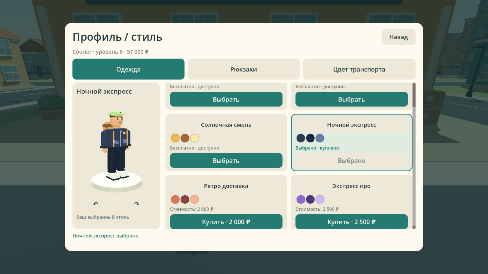
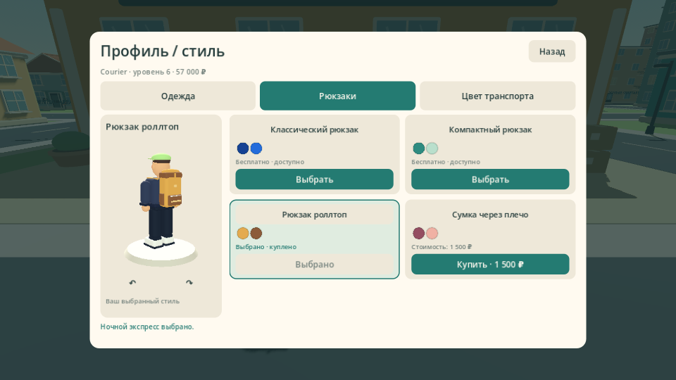
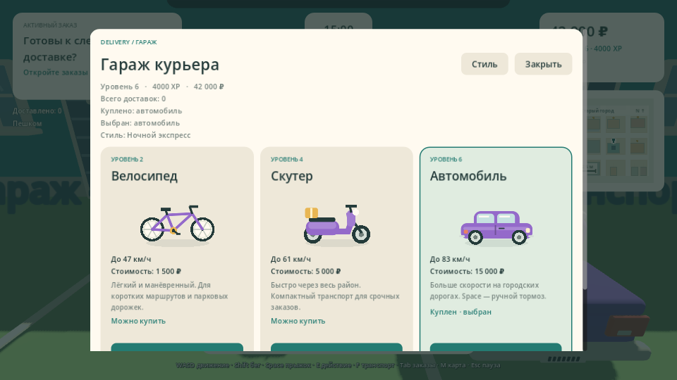
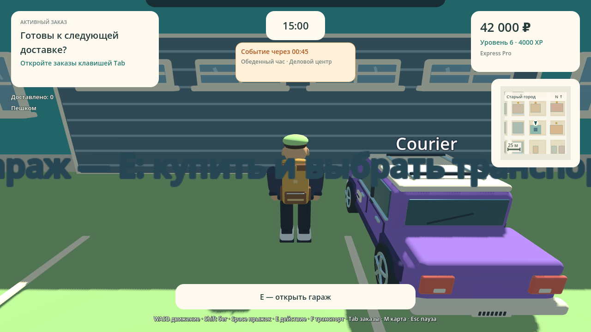

# Проверка Delivery Simulator Demo 0.13.0

[Сборка GitHub Actions 38351852584](https://github.com/Dinmukhamad/Delivery-Simulator/actions/runs/38351852584) успешно завершилась на коммите `e70dea0523ee980476988b2c614ea3557dcebbb3`. Последующие изменения документации и PNG не меняют проверенные скрипты, настройки и ресурсы игры.

Кастомизация доступна в Profile перед подключением и в Garage пешком во время смены: **6 вариантов одежды, 4 формы рюкзака, 6 вариантов окраски транспорта**. Бесплатные стили доступны сразу; дополнительные покупаются за заработанные деньги. Выбор и покупки хранятся в локальном профиле и показываются другим игрокам LAN.

## Подтверждённые результаты

| Проверка | Исходники | Windows PCK | macOS PCK |
|---|---:|---:|---:|
| Навигация и Solo | 688 | 688 | 688 |
| Геометрия, карты и транспорт | 649 | 649 | 649 |
| Генерация заказов и границы Host | 309 | 309 | 309 |
| Командная смена | 113 | 113 | 113 |
| Районные события | 197 | 197 | 197 |
| Кастомизация, совместимость и модели | 1219 | 1219 | 1219 |

Пять сценариев настоящего двухпроцессного ENet: навигация — **21** проверка, Team Shift — **36**, доставка в новых районах — **24**, «Обеденный час» — **42**, кастомизация и сохранение — **219**. Итого **9867 проверок**, без двойного подсчёта дублирующихся строк сетевого журнала.

- Старые профили 0.12.0 получают безопасный стандартный внешний вид; деньги, XP, статистика, купленный и выбранный транспорт сохраняются. Неизвестные ID и некупленные платные варианты не применяются.
- Проверены бесплатный выбор, точная стоимость покупки, нехватка денег, повторная покупка без второго списания, подмена цены/ID/профиля и отказ вдали от гаража или в транспорте.
- Host определяет цену и владельца; клиент получает подтверждённый профиль и сохраняет его. Краска и вид сидящего курьера обновляются у второго процесса.
- Одежда меняет только материалы куртки, кепки и брюк; рюкзаки имеют настоящую различающуюся геометрию. Проверены локальный/сетевой персонаж и велосипед/скутер/автомобиль, возврат заводской краски, колёса, седло, отражатели, стекло и свет.
- Повторные снимки не пересоздают модели, меши и материалы; изменение внешнего вида не меняет коллайдер, управление, скорость, характеристики транспорта, XP или результаты смены.
- Проверены обычные пути Solo через Profile и Garage, возврат в предыдущее окно и пауза после потери фокуса. Просмотр и вращение 3D-модели не покупают и не выбирают предмет.
- Сетевой сценарий записывает настоящие JSON-профили в отдельных временных XDG-папках Host/Client, проверяет каждое сохранённое поле в JSON-представлении и повторно загружает точный профиль производственным загрузчиком после выхода. Обычные личные файлы тестами не изменяются.
- Выполнены **20 настоящих рендеров**: прежние 16 города/навигации/Team Shift/события и четыре кадра кастомизации — меню 1280×720 и 960×540, гараж 960×540, персонаж и окрашенный автомобиль 1280×720. Проверены видимость кнопок/прокрутка всех вкладок, настоящая модель в отдельном 3D-просмотре, рабочая камера и отсутствие пересечения панелей.
- Подтверждены Windows PE x86_64, macOS Universal Mach-O Intel + Apple Silicon, SHA256 Godot 4.6.3/шаблонов и CRC ZIP. Параметры версии игры, LAN и экспорта установлены в 0.13.0.

Карта — 516 × 516 м, 104 здания, 18 точек получения и 51 адрес доставки. Team Shift, передача посылок, три обычных типа заказов и «Обеденный час» прошли прежние регрессионные проверки.

## Архивы

Ссылки ведут на внешние ZIP артефактов: распакуйте скачанный архив, затем ZIP игры внутри. SHA256 относится к внешнему архиву.

| Артефакт | Размер, байт | SHA256 |
|---|---:|---|
| [build-reports](https://github.com/Dinmukhamad/Delivery-Simulator/actions/runs/38351852584/artifacts/11791761604) | 3965303 | `1086cea1f19f9a9d4070cd04955f8846379a055c5edc3df5d5c23193306a7077` |
| [DeliverySimulatorDemo-Windows-v0.13.0](https://github.com/Dinmukhamad/Delivery-Simulator/actions/runs/38351852584/artifacts/11791746672) | 38943166 | `6052bad6b9952de5158df103a76b61325af4bc8c70a675c6a2461b56bfdb2370` |
| [DeliverySimulatorDemo-Source-v0.13.0](https://github.com/Dinmukhamad/Delivery-Simulator/actions/runs/38351852584/artifacts/11790614643) | 5654496 | `8ab018fe37a19e74d2c53d09872ee9c709791c5f3d0f841e7aee898ad24eef76` |
| [DeliverySimulatorDemo-macOS-v0.13.0](https://github.com/Dinmukhamad/Delivery-Simulator/actions/runs/38351852584/artifacts/11790374877) | 65431439 | `a76929f0d65ff01e0fd1a5772b74db399a52c9c105e9b50775be536bade16fce` |

Исходный архив CI содержит документацию на момент проверенного коммита. Актуальные отчёт и снимки находятся в текущей ветке репозитория.

## Пределы проверки

CI использует Linux-редактор Godot и программный OpenGL. Проверка точных экспортированных PCK подтверждает код и ресурсы, но не является нативным запуском EXE или macOS-приложения. Совместный LAN на 3–4 физических Windows/macOS-устройствах, FPS и слышимость звуков требуют ручной приёмки. macOS-сборка не нотарифицирована. Это согласованная отдельная Godot-демоверсия.

## Снимки

Кадры получены из настоящего интерфейса и моделей. Проверка задаёт начальные деньги/XP и положение персонажа, затем покупает стили и автомобиль обычными вызовами Main. Все цены списываются; окна показывают настоящий приобретённый внешний вид. В игре работает обычная камера SpringArm.

[Полный код, настройка и сценарий приёмки](CUSTOMIZATION.md) · [События](DISTRICT_EVENTS.md) · [Город](CITY_LAYOUT.md) · [Team Shift](TEAM_SHIFT.md)
