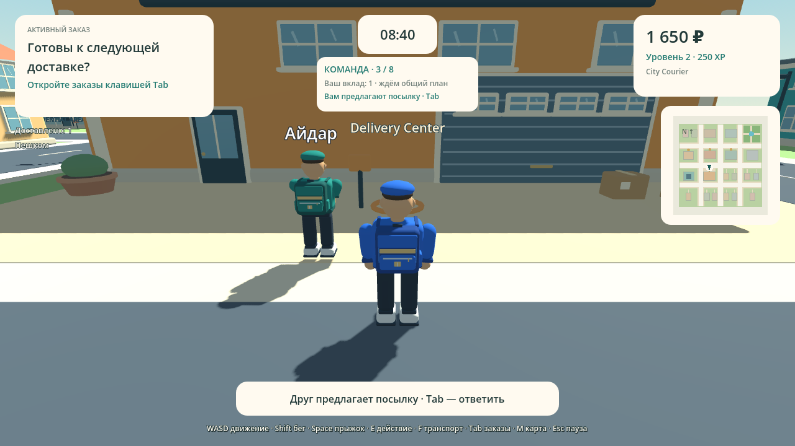
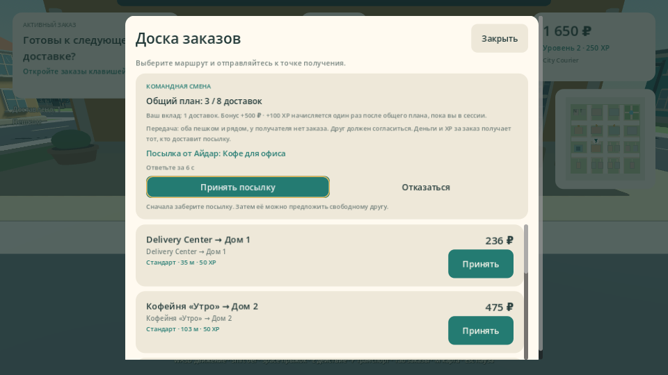
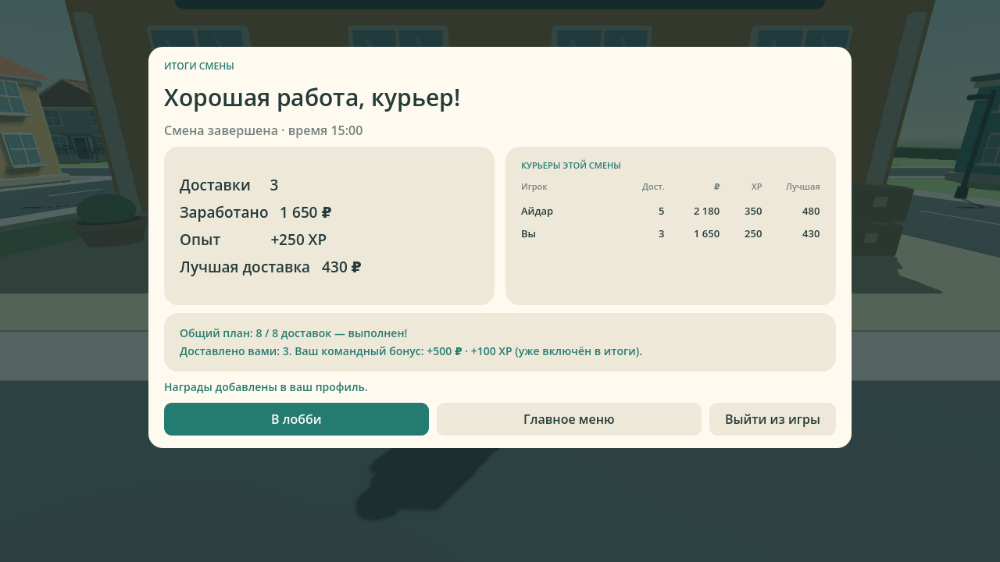

# Проверка демоверсии 0.10.0

Командный режим, передача посылок и исправленная панель результатов проверяются сборкой [GitHub Actions 38297836122](https://github.com/Dinmukhamad/Delivery-Simulator/actions/runs/38297836122) на игровом коммите `ee1d181fe1d591a7dc3a69ad1bc5a00b0598a141`. Сборка завершилась успешно.

В стандартном окне 1280×720 все кнопки результатов видны без прокрутки. При уменьшении окна панели используют прокрутку.

## Подтверждённые результаты

- Godot 4.6.3 импортирует проект без ошибок скриптов.
- 34 проверки навигации/Solo и 113 проверок командных правил выполняются на исходниках и на точных экспортированных Windows/macOS PCK.
- 21 проверка существующей LAN-навигации и 36 проверок командной смены выполняются в двух отдельных ENet-процессах.
- Это 498 проверок состояния, дополнительно к рендерам интерфейса.
- Клиент действительно перемещается и взаимодействует с полученной от Host посылкой; передача, завершение и бонус подтверждаются сервером.
- Реальная JSON-запись профиля проверяется в отдельных временных XDG-папках Host/Client. Требуются явные `--isolated-save` и `DELIVERY_TEAM_TEST_SAVE=1`; обычный test-mode не записывает личный профиль.
- Проверяются точный токен предложения, владелец, свободный получатель, состояние/дальность/видимость, срок, повторные запросы, сохранение качества и срока, отключение и однократный бонус.
- Карта отрисовывается при 1280×720 и 960×540; командный HUD, Tab и результаты — с данными проверки. При обновлении таймера сохраняются кнопки согласия и фокус.
- Подтверждаются Windows PE x86_64, macOS Universal Mach-O Intel + Apple Silicon, контрольные суммы шаблонов и CRC ZIP.

## Пределы проверки

На CI используется Linux-редактор Godot и программный OpenGL. Проверка экспортированного PCK подтверждает код и ресурсы, но не является нативным запуском EXE или приложения macOS. Снимки показывают реальный интерфейс и город с подготовленными данными проверки.

Ручной приёмки требуют запуск на Windows/macOS, совместный LAN на 3–4 физических устройствах, производительность и слышимость звуков на устройствах. macOS-сборка не нотарифицирована. Это отдельная Godot-демоверсия, не завершённая Unity-версия 1.0.

[Правила, полный код, настройка и сценарий приёмки](TEAM_SHIFT.md) · [Навигация](NAVIGATION.md)

## Архивы

Архивы GitHub Actions содержат ZIP игры или исходников. Сначала распакуйте скачанный архив, затем ZIP внутри. Приведённые SHA256 относятся к внешним архивам артефактов.

| Артефакт | Размер, байт | SHA256 |
|---|---:|---|
| [DeliverySimulatorDemo-Source-v0.10.0](https://github.com/Dinmukhamad/Delivery-Simulator/actions/runs/38297836122/artifacts/11769955426) | 2766296 | `e5f7659f6bc9f67bec5e3dce4f66c4b1d8cc4b0af564c88e0c6ded61f57176fc` |
| [DeliverySimulatorDemo-Windows-v0.10.0](https://github.com/Dinmukhamad/Delivery-Simulator/actions/runs/38297836122/artifacts/11768749891) | 38841350 | `cdd8579b6d1c9f693044d372d29fb47ffb9383d3a25e6568157d4569686b1fac` |
| [DeliverySimulatorDemo-macOS-v0.10.0](https://github.com/Dinmukhamad/Delivery-Simulator/actions/runs/38297836122/artifacts/11768744775) | 65329555 | `917a209deb1ee06b52d5e7dc832589e48234e2d0ca859a56805a86a8fd133450` |
| [build-reports](https://github.com/Dinmukhamad/Delivery-Simulator/actions/runs/38297836122/artifacts/11768389962) | 795170 | `e7f557b8b2e79a55b4c88f24d572c8715580aed5abfe658b80891ea346174488` |

Исходный архив CI содержит документацию на момент игрового коммита. Актуальный отчёт и изображения находятся в текущей ветке репозитория.

## Снимки интерфейса

Кадры сделаны Godot из игрового коммита с подготовленными данными проверки.

