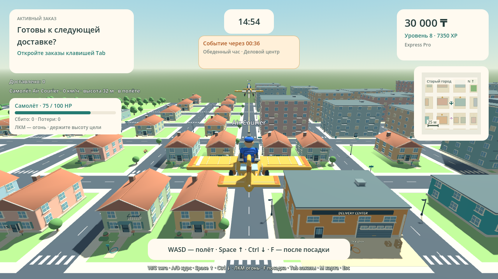
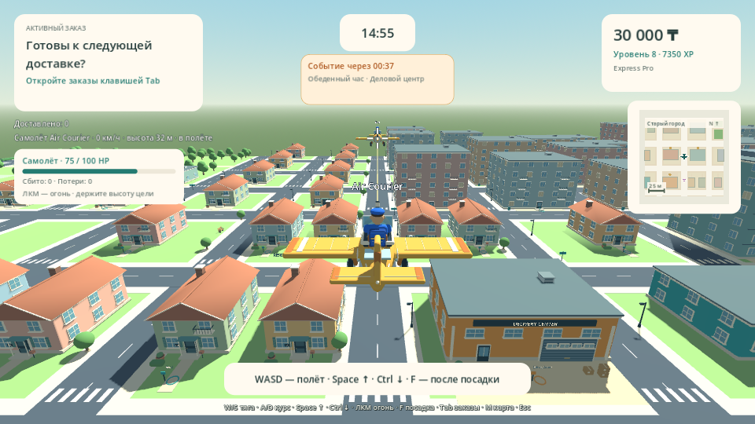

# Проверка Delivery Simulator Demo 0.16.0

Два курьера могут независимо купить самолёты и сбивать друг друга в одной LAN-смене. ЛКМ — огонь по курсу: **100 HP**, **25 урона**, четыре попадания, дальность **160 м**, интервал **250 мс**. Оба самолёта должны быть заняты и находиться от 2 м над землёй. Стены закрывают цель от огня.

Сбитый курьер возвращается к гаражу. Деньги, XP, покупки и текущая посылка сохраняются; уже купленный самолёт можно вызвать снова бесплатно с полной прочностью. Воздушный счёт относится только к смене и не выдаёт деньги или XP за доставки. Наземные курьеры, транспорт и припаркованные самолёты защищены.

[GitHub Actions 39558299768](https://github.com/Dinmukhamad/Delivery-Simulator/actions/runs/39558299768) успешно завершился на коммите `11130cb12121cab548c3af1536cce7d3188e5264`. Последующее добавление этого отчёта, ссылок и PNG меняет только README и документацию, сохраняя проверенный исполняемый код.

## Подтверждённые результаты

| Проверка | Исходники | Windows PCK | macOS PCK |
|---|---:|---:|---:|
| Навигация и Solo | 688 | 688 | 688 |
| Геометрия, карты и транспорт | 649 | 649 | 649 |
| Заказы и границы Host | 309 | 309 | 309 |
| Командная смена | 113 | 113 | 113 |
| Районные события | 197 | 197 | 197 |
| Кастомизация и профили | 1219 | 1219 | 1219 |
| Чит-коды и интерфейс | 449 | 449 | 449 |
| Самолёт, тенге и физика | 61 | 61 | 61 |
| Воздушный бой, восстановление и события | 113 | 113 | 113 |

Дополнительно выполнены **128 проверок с настоящим окном Xvfb**: захват мыши, одиночный выстрел, удержание ЛКМ, интервал, запрет огня в окнах и после освобождения мыши.

Восемь настоящих двухпроцессных сценариев ENet: навигация — **21**, Team Shift — **36**, доставка в новых районах — **24**, районное событие — **42**, кастомизация — **219**, чит-коды — **248**, полёт — **75**, воздушный бой — **90** (Host 43, Client 47). Всего **12 277 проверок**, без двойного подсчёта повторно напечатанных сетевых журналов.

- Оба сетевых игрока самостоятельно покупают собственные самолёты за точную цену; клиент сбивает Host, затем Host сбивает клиента. Проверены HP, один результат на сбитие, возвращение к гаражу, бесплатный повторный вызов, отдельные карьерные файлы и загрузка штатным JSON-загрузчиком.
- Host получает только поколение собственного самолёта отправителя. Позицию, направление, цель, дистанцию, урон и интервал он определяет сам. Проверены подмена полей, повторные запросы, старые поколения, окончание смены, отключение, ближайшая цель и перекрытие стенами, включая стену между центром самолёта и дулом.
- Повторные события не наносят повторный урон и не создают повторный результат. Старые выстрелы, события восстановления и пешие позы не удаляют новый самолёт после повторного вызова.
- Подтверждены проецируемый прицел на ближайшем видимом попадании, HP, отдельный счёт, вспышки, дым, падение обломка и ограниченный пул не более 24 групп эффектов с очисткой.
- Проверены оба новых оригинальных CC0 звука через общий AudioManager. Все 13 WAV соответствуют размерам, метаданным и SHA256 аудиоманифеста.
- Выполнены **29 настоящих кадров движка**: прежние 27 экранов плюс воздушный бой при 1280×720 и 960×540. Проверены весь самолёт по углам AABB мешей, размещение HUD, HP и попадание проекции прицела в проекцию самолёта противника.
- Подтверждены Windows PE x86_64, macOS Universal Mach-O Intel + Apple Silicon, SHA256 редактора Godot 4.6.3/шаблонов и CRC архивов. Версии приложения, LAN и экспортов — **0.16.0**.

Карта, доставки, Team Shift, районные события, кастомизация, чит-коды, тенге, четыре транспорта и прежние профили прошли регрессионные проверки. Карта остаётся 516 × 516 м: 104 здания, 18 точек получения и 51 адрес.

## Архивы

Распакуйте скачанный ZIP артефакта, затем ZIP игры внутри. Размеры и SHA256 внешних архивов взяты из метаданных GitHub.

| Артефакт | Размер, байт | SHA256 |
|---|---:|---|
| [DeliverySimulatorDemo-Source-v0.16.0](https://github.com/Dinmukhamad/Delivery-Simulator/actions/runs/39558299768/artifacts/12327621288) | 7411785 | `73d8a8bd9ed211dda5191b40e2f9e8cef0286be293fefeef8b435c9486cf735a` |
| [DeliverySimulatorDemo-Windows-v0.16.0](https://github.com/Dinmukhamad/Delivery-Simulator/actions/runs/39558299768/artifacts/12327601276) | 39006829 | `f9962d3922ab6b3f3907da416f2acc1e1e581653a316b5c8464a521f098409d3` |
| [DeliverySimulatorDemo-macOS-v0.16.0](https://github.com/Dinmukhamad/Delivery-Simulator/actions/runs/39558299768/artifacts/12327446867) | 65492681 | `988f289ccbc0437d396cc03313d863934bad57d6b35f70b1eb831b7755287620` |
| [build-reports](https://github.com/Dinmukhamad/Delivery-Simulator/actions/runs/39558299768/artifacts/12327287646) | 5892245 | `0f21ea54fcb749215da72a4b37ff85d00e03e9f4507f0f20a031be06023107b4` |

Исходный архив содержит документацию проверенного коммита. Этот итоговый отчёт и новые PNG добавлены отдельно в репозиторий.

## Пределы проверки

CI использует Linux Godot и программный OpenGL. Проверка точных экспортированных PCK подтверждает код и ресурсы, но не заменяет нативный запуск Windows EXE или macOS-приложения. Физическая смешанная LAN на 3–4 устройствах, FPS и слышимость звуков требуют ручной приёмки. macOS не нотарифицирована. Это согласованная отдельная Godot-демоверсия.

## Настоящие кадры

Кадры получены из настоящего игрового viewport. Защищённые test-mode фикстуры задают временную карьеру, логический Host-ростер и воздушный строй; оба самолёта покупаются штатными действиями, а настоящие запросы стрельбы проходят через Host. Два попадания оставляют каждому 75 HP. Постановочный второй участник этих кадров не выдаётся за сетевое соединение: настоящее соединение двух процессов проверяется отдельным ENet-сценарием выше.

[Полные исходники, настройка, управление и приёмка](AIR_COMBAT.md) · [Тенге и полёт](FLIGHT_TENGE.md) · [Чит-коды](CHEAT_CODES.md).
