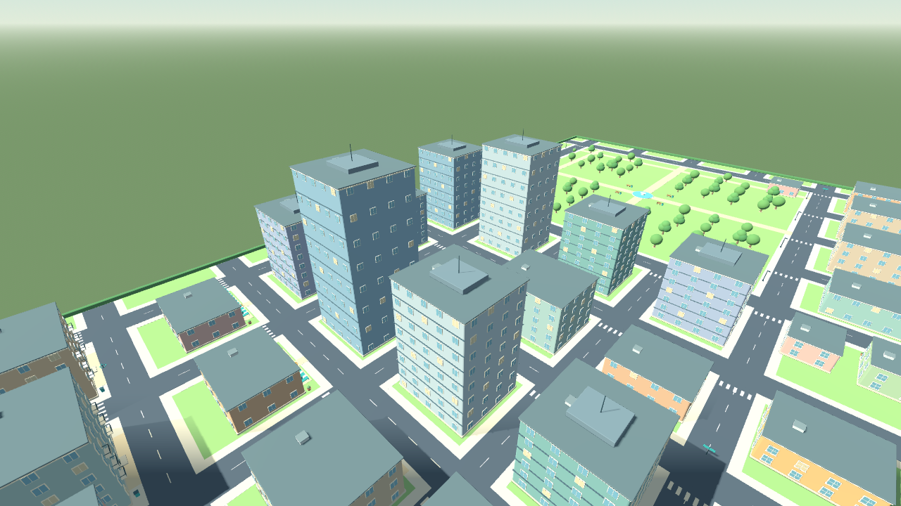
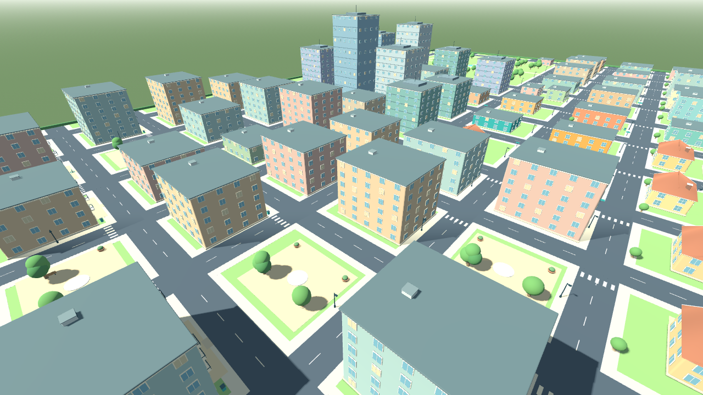
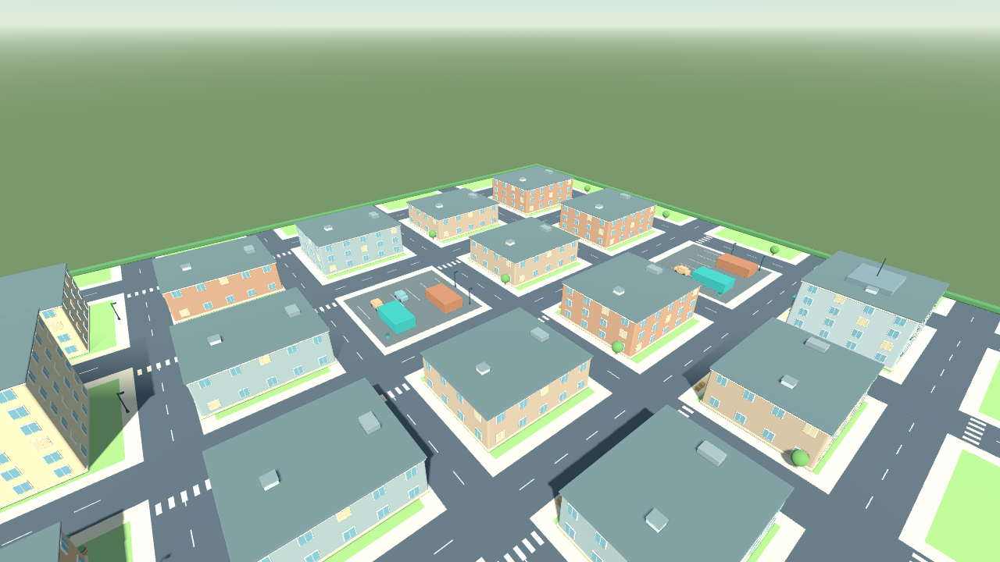
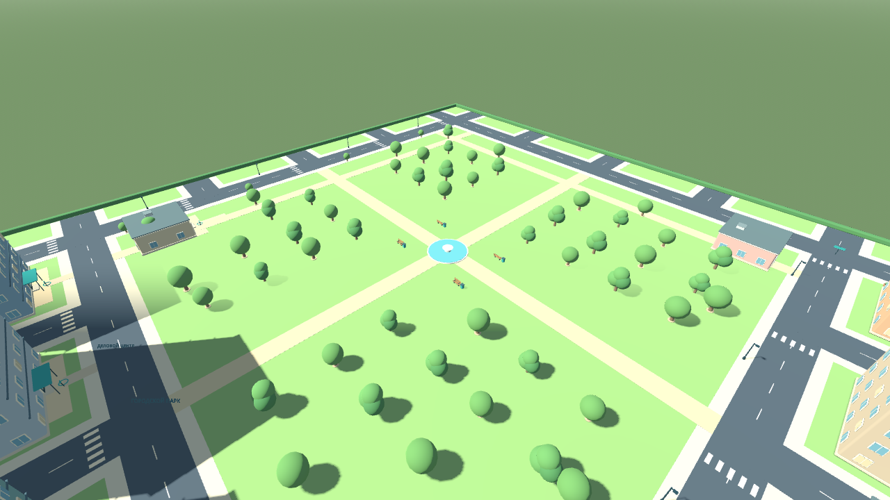
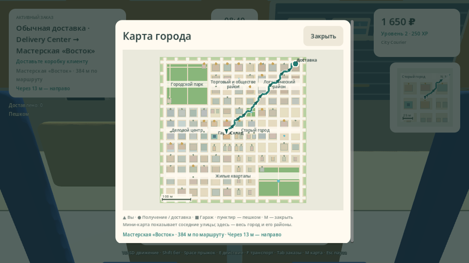

# Проверка Delivery Simulator Demo 0.11.0

[Сборка GitHub Actions 38325332235](https://github.com/Dinmukhamad/Delivery-Simulator/actions/runs/38325332235) завершилась успешно на игровом коммите `b6653148225ffa5d9666259e9a353495f8fdcf50`. Следующие изменения документации и снимков не меняют проверенный игровой код.

Карта — **516 × 516 м**, по три прежних размера в каждой стороне; **104 здания**, **18 точек получения**, **51 адрес доставки**. Все новые адреса имеют доступные подходы и маршруты.

## Подтверждённые результаты

| Проверка | Исходники | Windows PCK | macOS PCK |
|---|---:|---:|---:|
| Навигация и Solo | 688 | 688 | 688 |
| Геометрия, карты и транспорт | 649 | 649 | 649 |
| Генерация заказов и границы Host | 309 | 309 | 309 |
| Командная смена | 113 | 113 | 113 |

Дополнительно прошли **21** проверка LAN-навигации, **36** командного режима и **24** доставки в новых районах — каждая группа в двух настоящих ENet-процессах. Итого **5358 проверок**, без повторного подсчёта дублирующихся строк журнала.

- Каждый адрес достижим пешком; у адресов есть подъезд с дороги до 24 м. Проверены велосипедные и автомобильные маршруты между районами и отсутствие прямого fallback.
- Здания не пересекаются друг с другом или с асфальтом. Адреса свободны в реальной физике, башни имеют полные коллайдеры.
- Велосипед, скутер и автомобиль реально едут за прежнюю границу 84 м. Host принимает законные координаты на обоих новых краях и отклоняет выход за границу, телепортацию и поддельные награды.
- В сетевом сценарии начальная дальняя позиция задаётся доверенной тестовой фикстурой Host; затем клиент действительно движется, доставляет и получает подтверждение обычным сетевым путём. Сетевая безопасность не ослаблена.
- Профили Host/Client проверены настоящей JSON-записью в разных временных XDG-папках. Личные профили разработчика test-mode не меняет.
- Выполнены 12 рендеров: карты при 1280×720/960×540, командные HUD/Tab/results, четыре района и полная расширенная карта. Кнопки согласия, фокус и видимость всей M-карты проверены.
- Подтверждены Windows PE x86_64, macOS Universal Mach-O Intel + Apple Silicon, SHA256 редактора/шаблонов и CRC ZIP.

Построение навигационного профиля на CI заняло 8–10 мс для пешего режима/велосипеда и 2–3 мс для транспорта. Сетка 1 м сохраняет узкие проходы; пространственный индекс и кеш предотвращают полный поиск каждый кадр. Эти метрики не являются измерением FPS.

## Архивы

Ссылки ведут на внешние ZIP артефактов: распакуйте скачанный архив, затем ZIP игры внутри. SHA256 относится к внешнему архиву.

| Артефакт | Размер, байт | SHA256 |
|---|---:|---|
| [DeliverySimulatorDemo-Source-v0.11.0](https://github.com/Dinmukhamad/Delivery-Simulator/actions/runs/38325332235/artifacts/11780782028) | 3176376 | `d52cade3282ac13ac4bcb6a180adb1969d1e3b53e916274248721d5fe8399fe6` |
| [DeliverySimulatorDemo-Windows-v0.11.0](https://github.com/Dinmukhamad/Delivery-Simulator/actions/runs/38325332235/artifacts/11780622440) | 38875257 | `428bb94f2bddd01a5a108bd3b7095e1807af2c18735b3efc0fa4e91f9a142fc4` |
| [build-reports](https://github.com/Dinmukhamad/Delivery-Simulator/actions/runs/38325332235/artifacts/11780567531) | 2900536 | `eb3c85a0fcec0a3e38e0d0c046a30f6b2ccc8934921cdefff9a2a65e82db8541` |
| [DeliverySimulatorDemo-macOS-v0.11.0](https://github.com/Dinmukhamad/Delivery-Simulator/actions/runs/38325332235/artifacts/11780537590) | 65363286 | `8147ddca82fbeec24ad253f41cfed67c0aca5fd97fbfa9d5d6cd7580a3c41522` |

Исходный архив CI содержит документацию на момент игрового коммита. Актуальный отчёт и изображения находятся в текущей ветке репозитория.

## Пределы проверки

CI использует Linux-редактор Godot и программный OpenGL. Проверка точных экспортированных PCK подтверждает код и ресурсы, но не является нативным запуском EXE или macOS-приложения. Совместный LAN на 3–4 физических Windows/macOS-устройствах, FPS и слышимость звуков требуют ручной приёмки. macOS-сборка не нотарифицирована. Это согласованная отдельная Godot-демоверсия.

## Снимки

Кадры получены из настоящей геометрии игрового коммита. Обзорные камеры используются только проверкой; в игре сохраняется вид от третьего лица. M-карта показана с тестовой доставкой между реальными адресами.

[Размеры, полный код, настройка и приёмка города](CITY_LAYOUT.md) · [Командная смена](TEAM_SHIFT.md) · [Навигация](NAVIGATION.md)
